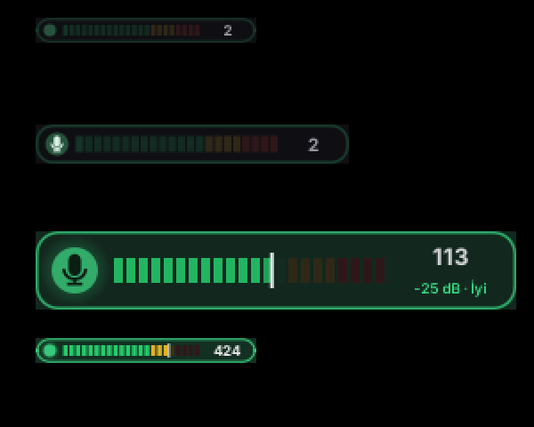
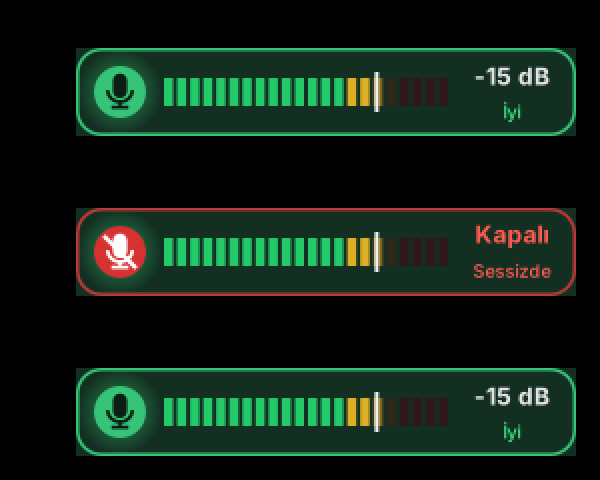
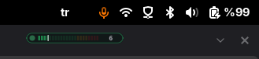

# MicMeter 🎙️

A tiny, always-on-top microphone level meter for **Windows** and **Linux (Fedora / GNOME / KDE)**.
See at a glance how much sound your mic is actually sending — during a Google Meet call or any time.

*Türkçe açıklama aşağıda.*

> ⚠️ **Disclaimer — vibe-coded project.** MicMeter was built entirely through "vibe coding" with Claude (Anthropic's AI).
> No secure software development lifecycle (SSDLC), code review, threat modelling or security testing was applied.
> It works on my machines (Windows 11 and Fedora) but use it at your own risk, and read the code before running it.



## Features

- **Always on top**, borderless, never steals focus — park it anywhere (e.g. in the GNOME top bar area)
- **Glow effect** — the dot and border get brighter as your voice gets louder
- **1–1000 sensitivity counter** — linear in amplitude, so even the faintest sound (breathing, keyboard) shows up as 1, 2, 3…
- **Click the mic icon to mute / unmute** the system microphone (affects every app, Meet included)
- Segmented level bar (green / yellow / red) with peak hold
- 3 sizes: **Mini** (124×14), **Small**, **Normal** (with dB + status)
- **Save position** — double-click returns it to your saved spot
- Pick the input device, start on login
- No dependencies on Windows (built with the C# compiler that ships with .NET Framework)



Parked in the GNOME top bar (Mini size):



## Install

### Windows
1. Download / clone the repo and open the `windows` folder.
2. Double-click **`build.bat`** → it builds `MicMeter.exe` and starts it.
   (If SmartScreen warns: *More info → Run anyway*.)

Requirements: Windows 10/11 (uses the built-in `.NET Framework 4` `csc.exe`).
Make sure *Settings → Privacy → Microphone → Let desktop apps access your microphone* is on.

### Linux (Fedora)
```bash
git clone https://github.com/canyorg/micmeter.git
cd micmeter/linux
./install.sh
```
The script installs missing packages with `dnf` (`python3-gobject`, `gtk3`, `python3-cairo`, `pulseaudio-utils`),
copies the app to `~/.local/bin/micmeter` and adds a menu entry.

Other distros: install the equivalent packages and run `python3 micmeter.py`.
Audio capture uses `parec`, `pw-record` or `arecord` — whichever is available (PipeWire & PulseAudio both work).

> On Wayland the app runs through XWayland (`GDK_BACKEND=x11`), because Wayland doesn't let apps
> position themselves or stay on top.

## Usage

| Action | What it does |
|---|---|
| Drag | Move the meter |
| Click mic icon | Mute / unmute the system mic |
| Double-click (strip) | Return to saved position |
| Right-click | Menu: mute, size, mic device, save position, move to bottom-right, start on login, quit |

**About the counter:** `value = RMS × 2000` (capped at 1000). Silence is never exactly 0 — the mic and
sound card always have a small noise floor (a laptop mic typically idles around 3–8).
Typing ≈ 7–10, normal speech ≈ 50–150, loud ≈ 400+.

---

## Türkçe

> ⚠️ **Not:** Bu proje tamamen Claude (Anthropic'in yapay zekâsı) ile "vibe coding" yöntemiyle yazıldı.
> Güvenli yazılım geliştirme yaşam döngüsü (SSDLC), kod incelemesi, tehdit modellemesi veya güvenlik testi uygulanmadı.
> Windows ve Fedora'da çalışıyor; kullanım riski size aittir, çalıştırmadan önce kodu inceleyin.

Windows ve Linux (Fedora) için küçük, her zaman üstte duran mikrofon seviye göstergesi.
Google Meet'te veya herhangi bir anda mikrofonuna ne kadar ses gittiğini anlık gösterir.

**Özellikler:** ses arttıkça parlayan gösterge · en hafif seste bile 1-2-3 gösteren **1–1000 sayaç** ·
mikrofon simgesine tıklayınca **sistem mikrofonunu kapat/aç** · 3 boyut (Mini / Küçük / Normal) ·
**konumu kaydet**, çift tıklayınca oraya döner · mikrofon seçimi · oturum açılınca başlatma.

**Kurulum**
- **Windows:** `windows` klasöründeki `build.bat`'a çift tıkla.
- **Fedora:** `cd linux && ./install.sh`

**Kullanım:** sürükle = taşı · mikrofon simgesine tık = sessize al/aç · çift tık = kayıtlı konuma dön · sağ tık = menü.

## License

MIT
